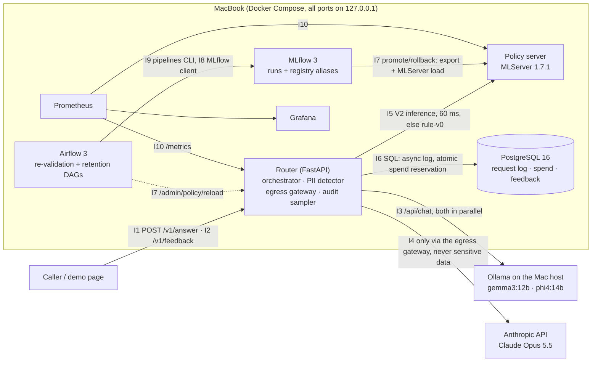

# Cost-aware LLM router

[](https://github.com/fatimabolehyool-cmd/llm-cost-router/actions/workflows/ci.yml)

A routing service for a bank help desk (MAAI7102 course project, MBZUAI). Two small models
running locally on a Mac answer each question first; the paid model (Claude Opus 5.5) is asked
only when the local answer is not trusted. Questions that contain personal data never leave the
Mac. Every answer comes back with a routing record: who answered, whether it was verified,
why, what it cost.

**Measured on the 689-question held-out test set** (`results/eval_summary_20261112-1728.md`):
the router is **86.5% accurate at $0.91 per 1,000 questions**, against 92.2% at $2.69 for
Opus on every question: **66% cheaper at 94% of its accuracy** (the proposal's target was
95%, so the quality target is narrowly missed). The local models alone reach 71–72%.

| | Real system | Tests and CI |
|---|---|---|
| Local "junior" models | gemma3:12b + phi4:14b on Ollama, on the Mac | `mock_models/` server (**mock**) |
| Paid "senior" model | Claude Opus 5.5, Anthropic Messages API | mock server; a recorded real reply for the adapter's contract test |
| Routing policy | logistic regression in MLServer 1.7.1, rule-v0 fallback | fake HTTP transport |
| Traffic | **replayed** public questions (MMLU, Banking77 as a help-desk stand-in), not live users | same |

## How it fits together



Balanced mode: both juniors answer in parallel; the policy predicts the probability that the
junior answer is right; above the threshold it is returned (free), otherwise Opus is asked
(paid) or, for sensitive data, the router abstains. If the policy server fails, the agreement
rule decides (rule-v0): cost can change, safety cannot. Details and decisions: the
implementation report; interface contracts: `docs/interfaces/`.

## Requirements

- macOS on Apple Silicon (built and measured on a MacBook Pro M5 Pro, 48 GB), `git`, `make`,
  Python 3.11+ (host tools), **Docker Desktop**.
- For the real system only: **Ollama** with `gemma3:12b` and `phi4:14b` (about 17 GB), and an
  **Anthropic API key** with prepaid credits. Neither is needed for the tests.
- Optional: `brew install gitleaks` for `make audit`.

## 1. Set up (10 minutes, no models, no key)

```bash
git clone https://github.com/fatimabolehyool-cmd/llm-cost-router.git
cd llm-cost-router
make venv          # host virtual environment (tests and scripts)
make env           # .env from .env.example, with local values (git-ignored)
make admin-key     # admin key for policy reload, written to .env (never printed)
make lint cov      # lint, 220 unit tests, coverage (fails below 80%)
make e2e           # builds the images, starts router + PostgreSQL + MOCK models, 11 workflow tests
```

`make e2e` needs Docker Desktop running; the first build downloads Python base images.

## 2. Run the real system

```bash
ollama pull gemma3:12b && ollama pull phi4:14b
```

Open `.env` in an editor and set the senior (never commit this file; it is git-ignored):

```
SENIOR_API_KEY=sk-ant-...      # your key
SPEND_CAP_USD=8                # the router refuses paid calls beyond this (atomic, in PostgreSQL)
```

```bash
make real-up                   # router (real juniors + Opus 5.5) + MLServer + PostgreSQL
make train FEATURES=v2         # Airflow: train, gate against rule-v0, register a challenger, shadow report
make registry                  # version numbers and gate results
make promote VERSION=<n>       # refused unless it passed the gate; serving switches without a restart
make real-ask                  # four real requests (< $0.01), prints each routing record
make demo                      # demo page: http://localhost:8000/demo (access key: dev-key-change-me)
make monitoring-up             # Prometheus http://localhost:9090, Grafana http://localhost:3000
```

Until a model is promoted the router decides with rule-v0 (the agreement rule); that is
expected on a fresh clone. The first `make train` builds the Airflow and MLflow images (several
minutes). The default caller key in `.env.example` is `dev-key-change-me` (local only: change
`ROUTER_API_KEY_SHA256` before any shared use).

**Model lifecycle in one command** (after `make real-up` and a promoted champion):
`make lifecycle-demo` tries to promote a model that failed the gate (refused), trains a new
challenger, writes the shadow report, promotes it and rolls back, with requests running during
both switches, and checks that the router never restarted (`results/lifecycle_demo_*.md`).

## 3. Tests and checks

| Command | What it proves | Needs |
|---|---|---|
| `make lint` | ruff lint and format, as in CI | – |
| `make cov` | 220 unit tests (routing rules, normalizer, privacy, adapters, policy, admin, metrics, shadow) and coverage ≥ 80% | – |
| `make test-integration` | 8 tests against a throwaway PostgreSQL 16: migrations, concurrent spend reservation, retention, feedback | Docker |
| `make e2e` | 11 end-to-end workflows on the Compose stack: every mode, feedback round trip, sensitive data never leaves or is stored in clear, junior/senior/input failures | Docker |
| `make s1` | S1: the stack starts, serves all modes, survives a database outage, recovers | Docker |
| `make s3` | S3 canary: 252+ sensitive requests, zero leaks to the provider, database or logs, including the audit path | Docker |
| `make restore-test` | timed backup and restore, verified by row counts | running stack |
| `make audit` | gitleaks over the full history + pip-audit of every lock file | gitleaks |

CI (GitHub Actions) runs lint, unit tests on Python 3.11 and 3.12, the integration tests
against a PostgreSQL service container, and the secret and dependency scans on every pull
request. `make e2e`, `make s1` and `make s3` leave the router running with **mock** models:
run `make real-up` afterwards to return to the real ones.

## 4. Examples

```bash
curl -s localhost:8000/v1/answer -H 'X-API-Key: dev-key-change-me' -H 'Content-Type: application/json' \
  -d '{"question": "Which planet is closest to the Sun?",
       "options": ["Venus", "Mercury", "Earth", "Mars"], "mode": "balanced"}'
```

```json
{"request_id": "req_3f2a9c1b7d4e", "status": "answered", "answer": "B", "verified": true,
 "escalated": false, "model": "gemma3:12b", "reason": "policy_accepted",
 "data_class": "non_sensitive", "cost_usd": 0.0, "latency_ms": 1410, "policy_p": 0.91, "task_type": "choice",
 "versions": {"api": "v1", "policy": "run-e1d8cf42", "prompt": "junior-prompts-v2", "junior1": "gemma3:12b",
              "junior2": "phi4:14b", "senior": "claude-opus-5-5"}}
```

- `task_type` is optional: the router reads exactly 4 options as `choice` (a question with
  options) and any other list as `label` (a customer message sorted into one of the request types
  you send, e.g. the 77 Banking77 intents in `data/banking77_labels.json`). Send it explicitly to
  override; the response says how the request was read. `mode`: `cheapest`, `balanced` (default),
  `best_quality`. `sensitive: true` forces local-only handling; personal data is also detected.
- Errors: `400 invalid_request` (also non-English questions), `401 unauthorized`,
  `503 overloaded | models_unavailable | database_unavailable`. A request the router cannot
  answer safely comes back `200` with `"status": "abstained"` and the reason.
- Feedback (I2): `POST /v1/feedback` with `{"request_id": "...", "flag": "wrong|correct|unsure",
  "note": "..."}`; `404 unknown_request` for an unknown ID.
- Admin (I7): `GET /admin/policy`, `POST /admin/policy/reload` with `X-Admin-Key`
  (`docs/interfaces/I7-policy-admin.md`). The caller key is never accepted there.

## 5. Configuration (`.env`)

| Variable | Meaning |
|---|---|
| `ROUTER_API_KEY_SHA256`, `ROUTER_ADMIN_KEY_SHA256` | SHA-256 of the caller and admin keys (only hashes reach the router; `make admin-key` rotates the admin key) |
| `SENIOR_PROVIDER`, `SENIOR_API_KEY`, `SENIOR_PRICE_IN/OUT` | `mock` or `anthropic`; the router refuses to start with `anthropic` and no `sk-ant-` key. Prices in USD per million tokens |
| `SPEND_CAP_USD` | global spend cap, enforced atomically before every paid call |
| `JUNIOR_TIMEOUT_S`, `JUNIOR_CONCURRENCY_CAP`, `BREAKER_*` | local-model timeout, overload limit, circuit breaker |
| `POLICY_URL`, `POLICY_TIMEOUT_S` | policy server (empty = rule-v0 only), 60 ms budget |
| `AUDIT_RATE`, `WARMUP` | share of accepted answers re-checked by the senior (default 5%); load the local models at start-up |
| `*_DB_PASSWORD`, `ROUTER_HASH_KEY`, `GRAFANA_ADMIN_PASSWORD` | local service credentials (change them for any shared use) |

The real-model settings (`infra/compose.real.yml`) layer on top of `docker-compose.yml`.
Ports: router 8000, MLServer 8090, MLflow 5001, Airflow 8081, Prometheus 9090, Grafana 3000,
mock models 9100, all bound to 127.0.0.1.

## 6. Evidence in `results/`

| File | What |
|---|---|
| `eval_summary_20261112-1728.md` | held-out evaluation: router vs Opus-only, Haiku-only, juniors, random routing, with 95% intervals |
| `e3_summary_*.md`, `e4_summary_*.md` | container → Ollama overhead (+1.3 ms per call); Opus vs Haiku on 200 questions |
| `revalidate_*.json`, `shadow_*.md` | release gate results; shadow comparison against the serving champion |
| `lifecycle_demo_*.md` | promote and rollback under live traffic, no restart |
| `s1_*`, `s3_canary_summary.md`, `backup_restore_*.md` | feasibility checks, privacy canary, timed restore |
| `exp1_*`, `exp2_*` | junior-pair selection (E1) and policy-server latency (E2), architecture phase |

## 7. Repository layout

```
router/        serving path: app (API), orchestrator, adapters, egress gateway, policy client,
               privacy, audit sampler, store (PostgreSQL), metrics, demo page (static/)
common/        shared by router and pipelines: normalizer, features, splits, statistics
pipelines/     CLIs: replay building, re-validation + gate, shadow report, registry (promote,
               rollback, hot reload), evaluation, retention
dags/          Airflow DAGs (they only schedule the CLIs)
deploy/        Prometheus config and alert rules, Grafana provisioning and dashboard
infra/         Dockerfiles, lock files, compose override for the real models
smoke/         checks S1–S3, lifecycle demo, backup drill, real requests
tests/         unit; integration/ (PostgreSQL); e2e/ (Compose stack)
docs/          interface contracts, dependency-audit decisions
exp*/          experiments from the architecture phase (kept for reproducibility)
data/          question pools with SHA-256 checksums; results/: measured outputs
```

## 8. Troubleshooting

| Symptom | Fix |
|---|---|
| `Docker is not running` / `Ollama is not reachable` | start Docker Desktop and wait for "Engine running"; open the Ollama app |
| `make real-up`: `container ... router-1 is unhealthy` | `docker compose logs --tail 40 router`. Usual causes: `SENIOR_API_KEY` missing for the anthropic provider, a malformed `ROUTER_ADMIN_KEY_SHA256` (re-run `make admin-key`) |
| Ports already in use | another copy of the stack is running: `make real-down` (or `make down`) in that folder |
| Answers come back abstained with `budget_exceeded` | the spend cap is reached: raise `SPEND_CAP_USD`, then `make real-up` |
| Admin call returns 403 / 401 | `make admin-key`, then `make real-up` (the router reads the key at start-up) |
| `make promote` exits 3 "serving did NOT switch" | the stack is not running: `make real-up`, then `make reload` |
| Grafana panels show "No data" | send a few requests (`make real-ask`), set the range to "Last 1 hour" |
| The router uses mock models after a check | `make real-up` |

## 9. Security and data

Secrets live only in `.env` (git-ignored); the router stores SHA-256 hashes of keys; gitleaks
scans the full history in CI; logs carry request IDs and outcomes, never question text;
request text is masked before storage and cleared after 30 days, rows after 180 days (daily
Airflow DAG). The router and policy-server images run as a non-root user, and the services
built here run with `no-new-privileges`. Data: MMLU (MIT licence),
Banking77 (CC BY 4.0). Built with AI assistance (Claude); see the report's AI-usage section.
