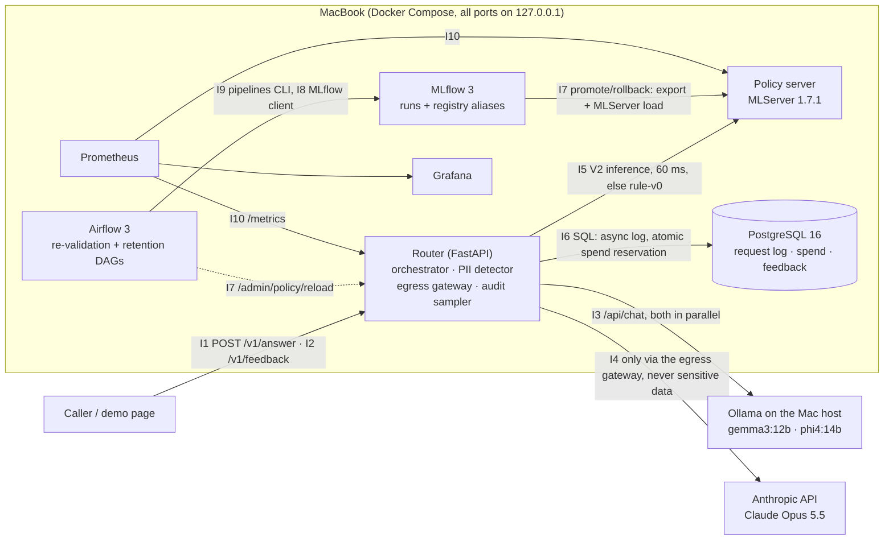

# Architecture as built

The router is one FastAPI service (a modular monolith, ADR-0) on one Mac. Two local models
answer each question first; a trained policy decides whether to trust them; only untrusted,
non-sensitive questions go to Claude Opus 5.5, and only through the egress gateway. MLflow,
Airflow, MLServer, Prometheus and Grafana run beside it in Docker Compose. Every part named here
was built and tested; what changed from the architecture deliverable is in the
[decision records](adr/README.md).

## How the parts fit together

The labels I1–I11 are the interfaces; their contracts are in
[interfaces/README.md](interfaces/README.md).

## Components

| Component | Code | Responsibility | Technology |
| --- | --- | --- | --- |
| Router API | `router/app.py` | I1 answer, I2 feedback, I7 admin reload, health, readiness, metrics, demo page; validation (400) and authentication (401) before any model call | FastAPI, Pydantic |
| Orchestrator | `router/orchestrator.py` | The three modes; both juniors in parallel; the policy decision; answer, escalate or abstain; at most 4 junior calls at once | asyncio |
| Junior adapters and normalizer | `router/adapters.py`, `common/normalizer.py` | Ollama chat calls (8 s timeout, circuit breaker); free text → one allowed option or "unreadable" | httpx |
| Privacy | `router/privacy.py` | A request is sensitive if flagged or if the detector finds an email, Emirates ID, phone number or Luhn-valid card number (fails closed); masking; keyed prompt hash. Names, addresses, IBANs and account numbers are not detected | regex, Luhn, HMAC |
| Egress gateway and senior adapter | `router/egress.py`, `router/adapters.py` | The only code that calls the provider: refuses sensitive data, reserves spend, calls Opus, settles the real cost | httpx, Anthropic Messages API |
| Policy client | `router/policy.py` | V2 inference call (60 ms); checks the served `model_version`; any failure → rule-v0 | httpx |
| Audit sampler | `router/audit.py` | Re-asks 5% of accepted answers in the background; disagreements go to a review queue | asyncio |
| Store | `router/store.py` (migrations in `MIGRATIONS`) | Numbered migrations, asynchronous request log, atomic spend reservation, feedback, audit results | asyncpg, PostgreSQL 16 |
| Policy server | `exp2_policy_serving/` image | Serves the champion model | MLServer 1.7.1, scikit-learn |
| Pipelines and DAGs | `pipelines/`, `dags/` | Replay building, training and release gate, shadow report, promotion and hot reload, evaluation, retention | Python CLIs, Airflow 3, MLflow 3 |
| Monitoring | `deploy/` | Scrapes the router and the policy server; 7 alert rules; dashboard provisioned from JSON | Prometheus 3.5, Grafana 12.1 |

## One request, end to end (balanced mode)

1. The API validates the body and the key; nothing reaches a model before both pass.
2. Privacy classifies the question: a sensitive flag or detected personal data makes it
   sensitive.
3. Both juniors answer in parallel; each reply is normalized to an allowed option or
   "unreadable".
4. The policy returns P(junior answer correct). At or above its threshold the junior answer is
   returned, free.
5. Below it, a non-sensitive question goes to the egress gateway, which reserves the cost, calls
   Opus and settles; a sensitive one is answered "abstained".
6. The routing record is queued for PostgreSQL (masked text, keyed hash) and returned; a logging
   failure never fails the request. Eligible answers may be audited afterwards.

## Model lifecycle

The weekly `revalidate_policy` DAG trains a challenger, gates it against rule-v0 with
`common/release_gate.py` (accuracy, coverage, false acceptance and an exact sign test), registers
it in MLflow and writes a shadow report against the serving champion. A person promotes a model
that passed with `make promote`; `make rollback` restores the previous champion. Both switch the
policy without restarting the router (I7, ADR-31). `make lifecycle-demo` runs the whole cycle
under live traffic.

## What runs where

| Where | What |
| --- | --- |
| Mac host | Ollama with the two juniors (Apple GPU; ADR-8) |
| Docker Compose | Router and PostgreSQL 16; MLServer (profile `policy`); MLflow (profiles `lifecycle`, `orchestration`); Airflow (profile `orchestration`); Prometheus and Grafana (profile `monitoring`); mock models for tests (profile `mocks`). Every port is bound to 127.0.0.1 |
| Anthropic | Claude Opus 5.5, reached only through the egress gateway |
| GitHub Actions | Lint, unit tests on Python 3.11 and 3.12, PostgreSQL integration tests, gitleaks and pip-audit |

The README gives the commands; the evaluation and every other measurement are in `results/`.
